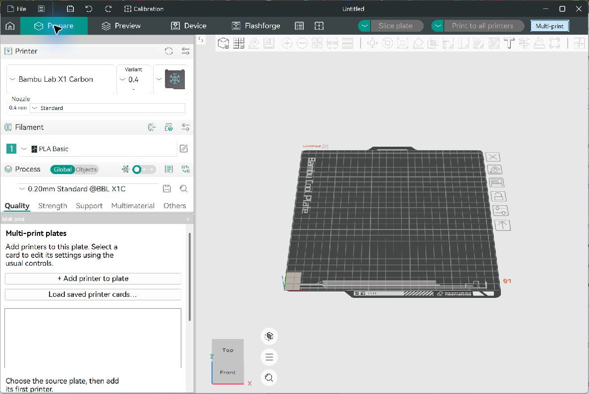

# Orqa Slicer

A Windows slicer workspace combining Bambu and Flashforge printer accounts,
cloud printing, a Multi-print workspace, and a SolidWorks **Orqa Print** add-in.

Current local preview: **0.1.0-dev.13**. Current SolidWorks add-in: **0.1.0.16**.
This is a development preview; live CAD and printer acceptance is still in progress.



## Use your existing installation

- Open **Launch-Slicer.cmd** to launch the selected version.
- Open **Manage-Versions.cmd** to select a version, read its notes, or roll back.
- Run **Install SolidWorks Add-in.cmd** to install the built add-in, then enable
  **Orqa Print** in SolidWorks under **Tools → Add-ins**. See the
  [SolidWorks workflow](docs/solidworks-workflow.md).

Keep the existing `versions/` folder: it contains your builds and private settings.
Pulling source changes from GitHub does not update an installed executable.
Build and publish a new version when a source update is ready to use.

## Start from GitHub on a new PC

This repository contains source, patches, scripts and documentation. It excludes
compiled applications, dependency caches, accounts, presets and vendor plug-ins.
A fresh clone must be built before the launchers or add-in installer can be used.

Prerequisites: Windows x64, Git, Visual Studio C++ Build Tools with the Desktop
C++ workload, and a Windows SDK. Upstream guidance calls for at least 16 GB RAM
and 23 GB free disk; retaining multiple portable versions requires more space.

Open PowerShell in the folder where you want the project:

```powershell
git clone https://github.com/beansexe/orqa-slicer.git
cd orqa-slicer
.\manage.ps1 Doctor
.\manage.ps1 Setup
.\scripts\setup-build-tools.ps1
.\manage.ps1 BuildDeps
.\manage.ps1 Build
.\manage.ps1 Publish -Version 0.1.0-dev.13
.\manage.ps1 Use -Version 0.1.0-dev.13
.\manage.ps1 Run
```

`Setup` retrieves the locked vendor baselines and preserves existing checkouts.
`Build` applies the native patch, synchronizes integration sources and enables
`ORCA_DUAL_VENDOR_ACCOUNTS`. Build commands default to four parallel jobs; use
`-Jobs` to adjust for available memory. Portable CMake, Perl and the pinned Python
bootstrap are installed into the excluded `tools/` directory.

If script execution is blocked, use a process-scoped invocation such as
`powershell -NoProfile -ExecutionPolicy Bypass -File .\manage.ps1 Doctor`.

The optional Community Cloud backend has its own
[build script](scripts/build-community-bambu.ps1),
[source lock](integration/community/sources.lock.json) and
[staging checks](scripts/stage-community-bambu.ps1). It requires the native slicer
dependency build. The standard backend remains the default on a new setup.
Flashforge requires a separately obtained compatible vendor networking plug-in
and its `FLASHNETWORK9.DAT` file (ABI 3.3.6). Choose plugin in Printer accounts
when automatic discovery is unavailable.

For the SolidWorks add-in, install SolidWorks with its API assemblies, then run
`./scripts/build-solidworks.ps1` before using the add-in installer.

## Update, test and roll back

Make changes on a branch, then run `./scripts/check.ps1`. GitHub Actions runs
these same source-only checks on Windows; they do not contact printers or accounts
and do not require the full slicer build. See [Contributing](CONTRIBUTING.md) for
source layout, native patch capture and release checks.

After a successful native build, publish with a **new version label**:

```powershell
# Example for an existing installation with revision 1's shared settings:
.\manage.ps1 Publish -Version 0.1.0-dev.14 -SettingsVersion 0.1.0-dev.1
.\manage.ps1 Use -Version 0.1.0-dev.14
```

Use your actual new version label and release notes. `-SettingsVersion` must name
an existing published revision with a `data_dir`; omit it on a fresh installation.
It references that revision's settings rather than copying credentials. Keep the
referenced folder and close the slicer before switching versions. Use the workspace
launchers so the shared settings reference takes effect. Existing versions remain
available for rollback; `Publish` will not overwrite a version.

`./manage.ps1 Fetch` downloads upstream changes without merging or resetting local
edits. Updating a baseline is a separate development step: inspect and merge the
changes, verify the integration, then update the lock. Local `Publish` creates a
portable version; it does not upload a GitHub release or provide automatic updates.

For distribution after building and committing the release source and notes:

```powershell
.\manage.ps1 Verify
.\scripts\package-release.ps1 -Version 0.1.0-dev.14 -ReleaseNotes docs/revisions/0.1.0-dev.14.md
```

The package includes a portable launcher, an empty settings directory, release
notes, matching workspace source and a SHA256 checksum. It is written under
`artifacts/releases/` for inspection and upload; the staging folder is retained.
It does not change your selected installation. Standalone packages use their own
settings; keep your existing installation for rollback.

## Features and current verification

| Feature | Current status |
| --- | --- |
| Bambu Community Cloud | X2D homing, live video and cloud printing confirmed by the user; other Bambu models still need testing. |
| Flashforge cloud | Cloud printing and pause/resume/cancel confirmed previously; delayed bed temperature reporting remains unresolved. |
| Multi-print | Shared source plate with per-printer cards, presets and validated slices; live batch workflow still needs user testing. |
| SolidWorks bridge | Live printer/preset selection, STEP export and background single-material external-spool printing; live CAD/printing acceptance pending. Use Load in slicer for AMS or multiple extruders. |
| Fast Start warning | At 10 cm³ or greater, model-based printing asks for explicit confirmation. Cancel is the default. Native and bridge policy checks pass; live acceptance pending. |

The add-in's **Load in slicer** and **Choose and print** commands use the running
Orqa session, including compatible unsaved material/process edits. Keep Orqa
running and signed in. Add-in 16 restores SolidWorks focus when its chooser closes;
a successful Load in slicer intentionally hands focus to Orqa.

Multi-print workspaces save a standard 3MF and a companion printer-card file.
Keep both together; reopen the 3MF and load its saved cards. Native send confirmation
preserves vendor-specific AMS review. See the
[Multi-print checklist](docs/revisions/0.1.0-dev.11-user-tests.md),
[Fast Start notes](docs/revisions/0.1.0-dev.13.md) and
[add-in 16 notes](docs/solidworks-addin-0.1.0.16.md).

[Migration and release readiness](docs/github-migration.md) records verified work
and remaining acceptance gates. Historical development notes describe their
original revisions; they are not a claim that all hardware paths are validated.

## Sources and notices

- [OrcaSlicer](https://github.com/OrcaSlicer/OrcaSlicer)
- [Orca-Flashforge](https://github.com/FlashForge/Orca-Flashforge)
- [OrcaSlicer Windows build guide](https://github.com/OrcaSlicer/OrcaSlicer/wiki/how_to_build_windows)

Preserve the upstream AGPL terms and dependency notices. Vendor networking
binaries and SolidWorks API assemblies have separate terms and are not included
in this source repository. See [LICENSE.txt](LICENSE.txt) and [NOTICE.md](NOTICE.md).
